# Kiểm thử hiệu năng website bằng Apache JMeter

- **Họ tên:** *(điền tên của bạn)*
- **MSSV:** *(điền mã số sinh viên)*
- **Lớp / Học phần:** *(điền thông tin lớp)*

## 1. Giới thiệu

- **Mục tiêu:** tìm hiểu công cụ Apache JMeter và thực hành kiểm thử hiệu năng (performance testing) một website với nhiều mức tải khác nhau.
- **Công cụ:** Apache JMeter 5.6.3, Java 17
- **Website kiểm thử:** https://blazedemo.com (website mẫu dành cho luyện kiểm thử)
- **Kịch bản:** người dùng đặt vé máy bay gồm 4 bước: vào trang chủ, tìm chuyến bay, chọn chuyến bay, thanh toán.

## 2. Cơ sở lý thuyết

**Kiểm thử hiệu năng** là đo khả năng đáp ứng của hệ thống (thời gian phản hồi, số request xử lý được, tỉ lệ lỗi) khi có nhiều người dùng truy cập cùng lúc.

**Apache JMeter** là công cụ mã nguồn mở viết bằng Java, dùng để giả lập nhiều người dùng ảo gửi request đến server và đo kết quả.

Các thành phần chính đã sử dụng:

| Thành phần | Vai trò |
|---|---|
| Test Plan | Khung chứa toàn bộ kịch bản kiểm thử |
| Thread Group | Khai báo số người dùng ảo (Threads), thời gian khởi động (Ramp-up), số vòng lặp (Loop Count) |
| HTTP Request Defaults | Khai báo server mặc định cho mọi request |
| HTTP Cookie Manager | Mỗi người dùng ảo giữ cookie riêng như trình duyệt thật |
| HTTP Request (Sampler) | Một yêu cầu HTTP gửi đến server |
| Response Assertion | Kiểm tra nội dung hoặc mã trạng thái trả về có đúng không |
| Listener | Hiển thị kết quả (View Results Tree, Summary Report, Aggregate Report) |

Các chỉ số quan trọng:

| Chỉ số | Ý nghĩa |
|---|---|
| # Samples | Tổng số request đã gửi |
| Average | Thời gian phản hồi trung bình (ms) |
| Median | Giá trị giữa: 50% request nhanh hơn mức này |
| 90% Line | 90% request có thời gian phản hồi nhanh hơn mức này |
| Error % | Tỉ lệ request bị lỗi |
| Throughput | Số request server xử lý được mỗi giây |

**Tài liệu tham khảo:**
- Apache JMeter User's Manual: https://jmeter.apache.org/usermanual/index.html
- *(ghi thêm link video hoặc tài liệu bạn đã học)*

## 3. Cài đặt môi trường

1. Cài Java (JDK 17), kiểm tra bằng lệnh `java -version`:

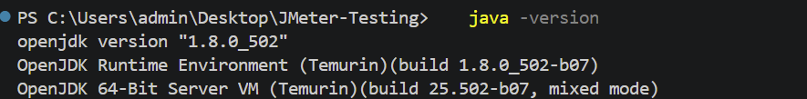

2. Tải Apache JMeter 5.6.3 từ https://jmeter.apache.org/download_jmeter.cgi, giải nén và chạy `bin/jmeter.bat`:

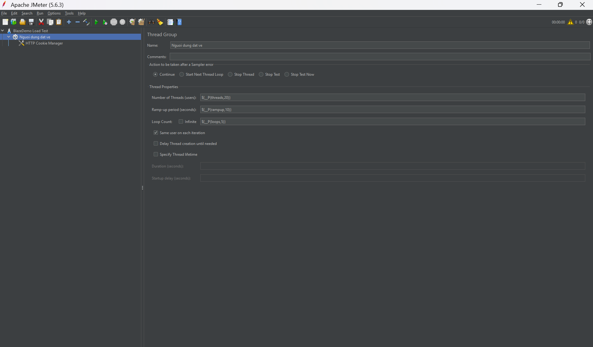

## 4. Kịch bản kiểm thử

| Bước | Request | Phương thức | Đường dẫn | Kiểm tra (Assertion) |
|---|---|---|---|---|
| 1 | Trang chủ | GET | `/` | Trang chứa "Welcome to the Simple Travel Agency" |
| 2 | Tìm chuyến bay | POST | `/reserve.php` | Trang chứa "Choose This Flight" |
| 3 | Chọn chuyến bay | POST | `/purchase.php` | Mã phản hồi bằng 200 |
| 4 | Thanh toán | POST | `/confirmation.php` | Trang chứa "Thank you for your purchase today" |

## 5. Xây dựng Test Plan

### 5.1 Cấu trúc tổng thể

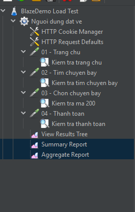

### 5.2 Thread Group

Cấu hình mặc định: 20 người dùng ảo, Ramp-up 10 giây, mỗi người lặp 5 lần. Số người dùng được truyền qua tham số `-Jthreads` khi chạy dòng lệnh để thử nhiều mức tải.


### 5.3 HTTP Request

Server mặc định được khai báo một lần trong HTTP Request Defaults (Protocol: `https`, Server Name: `blazedemo.com`), nên mỗi request chỉ cần khai báo phương thức, đường dẫn và tham số.

Ví dụ request "Tìm chuyến bay":

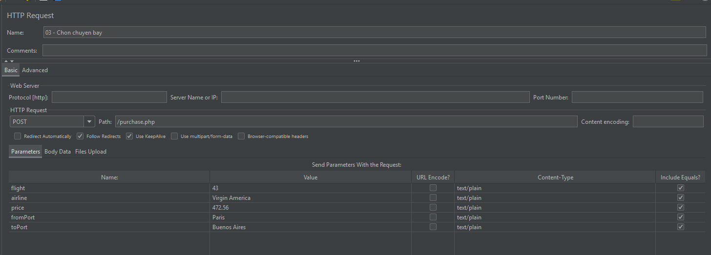

### 5.4 Assertion

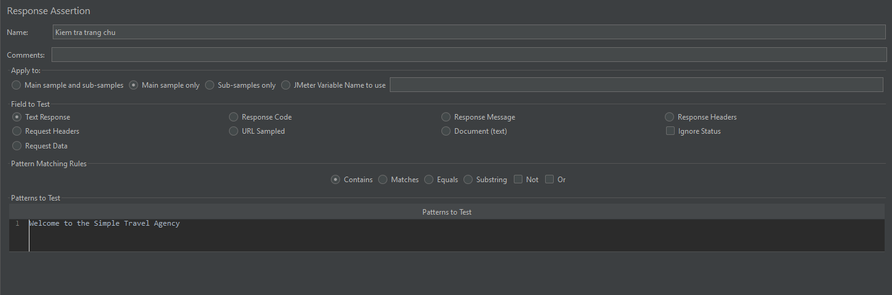

Khi cố ý đặt sai nội dung cần kiểm tra, request bị đánh dấu lỗi:


## 6. Kết quả thực hiện

### 6.1 Chạy trên giao diện JMeter

**View Results Tree:** các request thành công hiển thị dấu xanh.

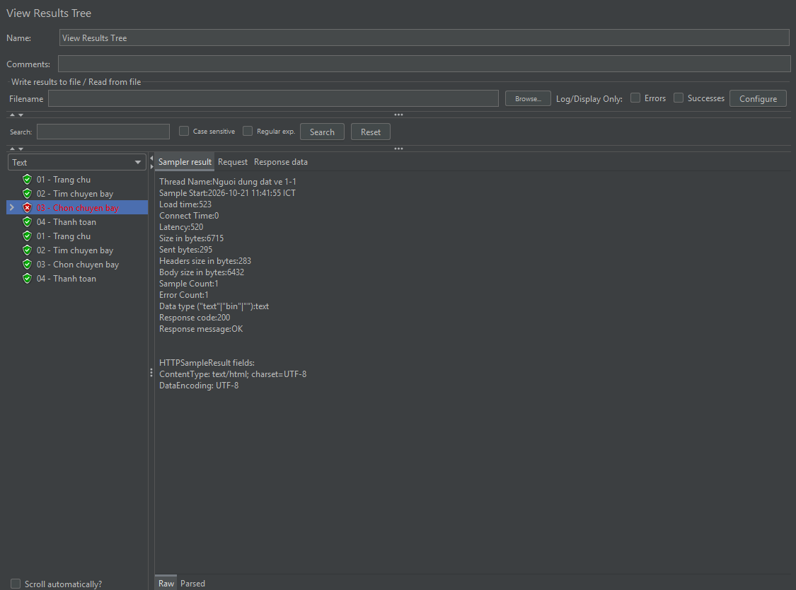

**Summary Report:**

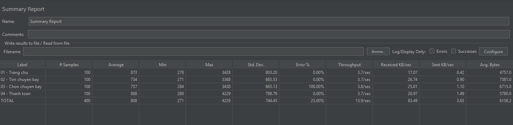

**Aggregate Report:**

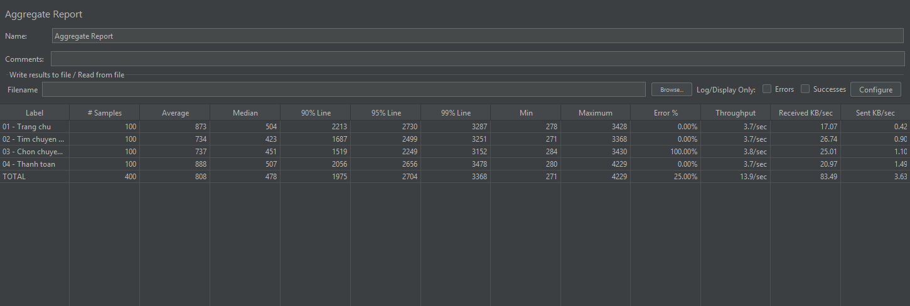

### 6.2 Chạy bằng dòng lệnh với 3 mức tải

Lệnh chạy (thay `10` bằng `30`, `50` cho các mức còn lại):

```powershell
jmeter -n -t blazedemo_test_plan.jmx -Jthreads=10 -l results_10.jtl -e -o report_10
```

**Mức 10 người dùng:**

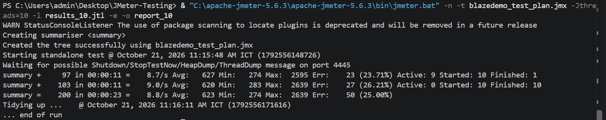
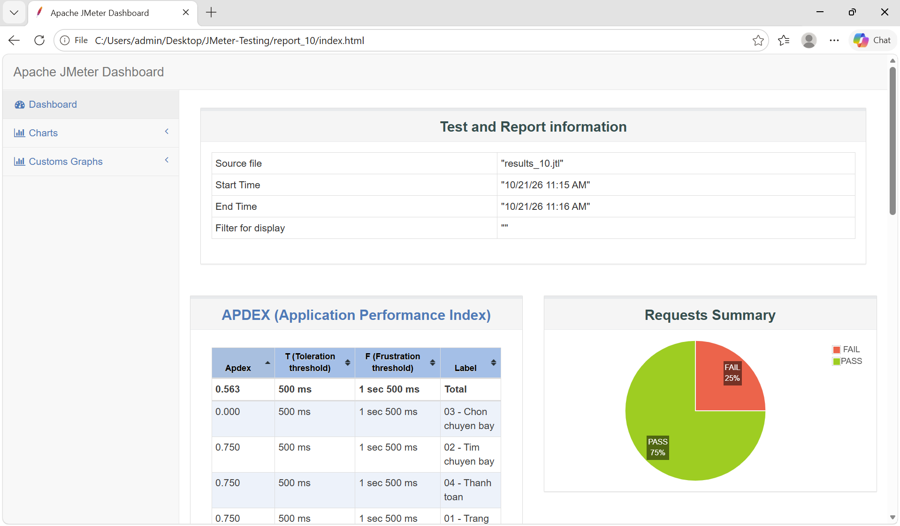

**Mức 30 người dùng:**

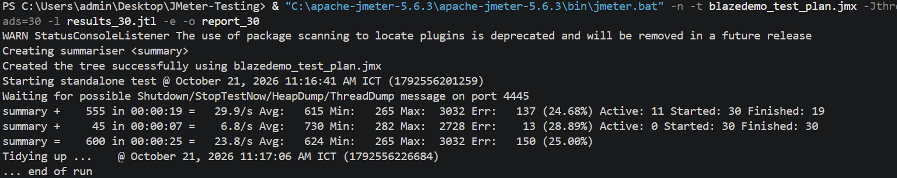
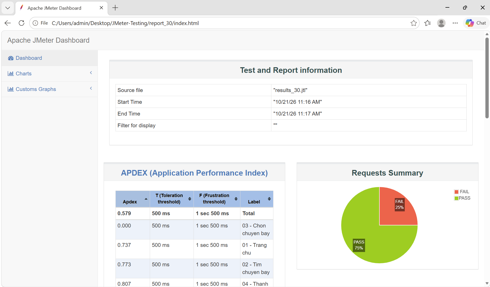

Biểu đồ thời gian phản hồi theo thời gian (mức 30 người dùng):

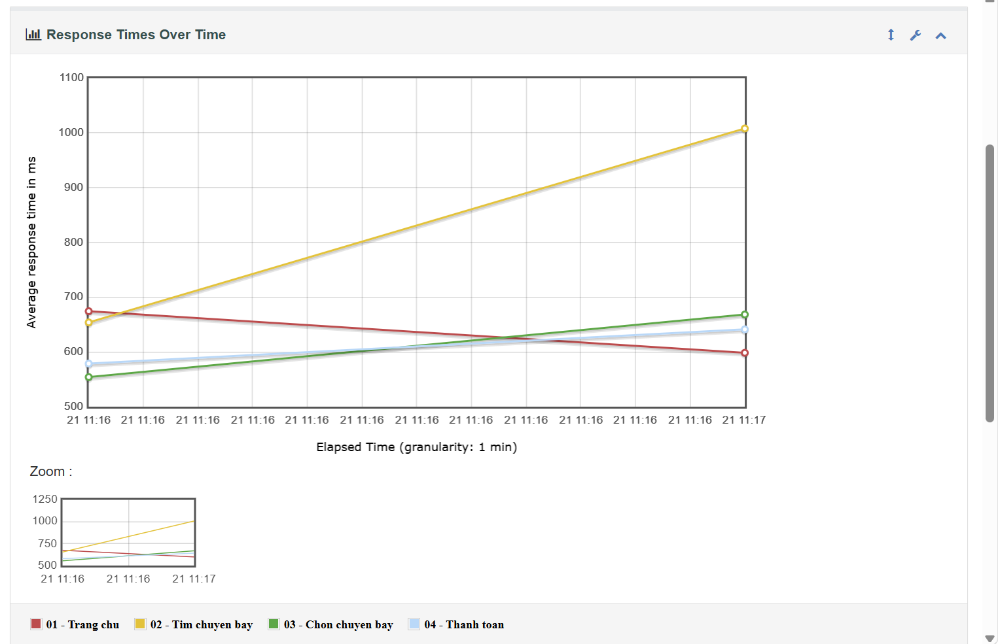

**Mức 50 người dùng:**

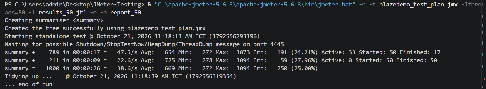


Báo cáo HTML đầy đủ của từng mức nằm trong các thư mục `report_10`, `report_30`, `report_50` của repo (mở file `index.html`).

## 7. Phân tích và đánh giá

### 7.1 Bảng so sánh các mức tải

Số liệu lấy từ dòng `summary =` cuối cùng của mỗi lần chạy dòng lệnh:

| Số người dùng | Tổng request | Average (ms) | Min (ms) | Max (ms) | Error % | Throughput (req/s) |
|---|---|---|---|---|---|---|
| 10 | 200 | 623 | 274 | 2639 | 25,00 (50/200) | 8,8 |
| 30 | 600 | 624 | 265 | 3032 | 25,00 (150/600) | 23,8 |
| 50 | 1000 | 669 | 272 | 3094 | 25,00 (250/1000) | 38,6 |

**Lưu ý về tỉ lệ lỗi:** tỉ lệ lỗi giữ nguyên đúng 25% ở cả ba mức tải, tức là cứ 4 request thì có 1 request bị đánh dấu lỗi. Khi kiểm tra request thứ 3 (`03 - Chon chuyen bay`), server trả về mã `200 OK` và trang tải đầy đủ, nhưng JMeter vẫn ghi nhận lỗi, nên nguyên nhân là phần Assertion của request này được cấu hình chưa đúng chứ không phải do server quá tải. Vì vậy con số lỗi 25% không phản ánh hiệu năng thực tế của website.

### 7.2 Nhận xét

- Khi tăng số người dùng từ 10 lên 50 (gấp 5 lần), thời gian phản hồi trung bình gần như không đổi: từ 623 ms lên 669 ms (tăng khoảng 7%). Thời gian phản hồi tối đa tăng nhẹ từ 2639 ms lên 3094 ms.
- Throughput tăng từ 8,8 lên 23,8 rồi 38,6 req/s, tăng gần theo số người dùng, cho thấy server vẫn xử lý tốt trong phạm vi 10 đến 50 người dùng.
- Tỉ lệ lỗi là 25,00% ở cả ba mức và không thay đổi theo tải, do request thứ 3 bị Assertion đánh dấu lỗi như đã giải thích ở trên. Vì lỗi không tăng khi tải tăng nên không có dấu hiệu server quá tải ở các mức đã thử.

## 8. Kết luận

- Đã xây dựng thành công test plan JMeter cho kịch bản đặt vé gồm 4 request, có Assertion kiểm tra kết quả.
- Đã chạy kiểm thử ở 3 mức tải (10, 30, 50 người dùng) và xuất báo cáo HTML.
- Nhận định chung về hiệu năng của website: trong phạm vi 10 đến 50 người dùng, thời gian phản hồi trung bình ổn định ở mức khoảng 0,6 đến 0,7 giây và throughput tăng gần tuyến tính theo tải. Tỉ lệ lỗi 25% ở mọi mức tải xuất phát từ cấu hình Assertion của request thứ 3, không phải do website.
- Cách khắc phục: đặt Assertion của request thứ 3 kiểm tra Response Code bằng 200 (hoặc kiểm tra một đoạn chữ có thật trên trang), sau đó chạy lại để có số liệu không còn lỗi.
- Hạn chế: website demo công cộng, mức tải nhỏ, kết quả phụ thuộc đường truyền mạng của máy kiểm thử.
- Hướng phát triển: tăng tải, dùng CSV Data Set để mỗi người dùng đi một tuyến bay khác nhau, thêm Timer để mô phỏng thời gian suy nghĩ của người dùng.

## 9. Hướng dẫn chạy lại

1. Cài Java 17 và Apache JMeter 5.6.3.
2. Clone repo này về máy.
3. Mở PowerShell tại thư mục repo và chạy (thay đường dẫn `jmeter.bat` theo máy của bạn):

```powershell
& "C:\apache-jmeter-5.6.3\apache-jmeter-5.6.3\bin\jmeter.bat" -n -t blazedemo_test_plan.jmx -Jthreads=10 -l results_10.jtl -e -o report_10
```

Thư mục `report_10` phải chưa tồn tại trước khi chạy. Có thể mở `blazedemo_test_plan.jmx` trực tiếp bằng giao diện JMeter để xem và chỉnh sửa test plan.

## 10. Cấu trúc repo

```
JMeter-Testing/
├── blazedemo_test_plan.jmx   # Test plan JMeter
├── report_10/                # Báo cáo HTML mức 10 người dùng
├── report_30/                # Báo cáo HTML mức 30 người dùng
├── report_50/                # Báo cáo HTML mức 50 người dùng
├── images/                   # Ảnh chụp minh họa
├── .gitignore
└── README.md
```